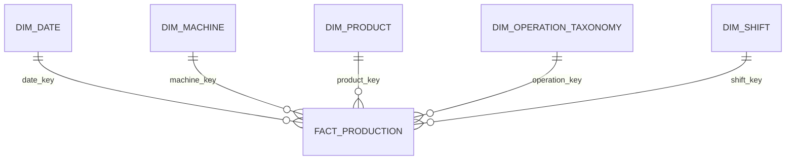

# Проєктування зіркової схеми

## 1. Бізнес-процес і зерно факту
Бізнес-процес: облік виконання виробничих операцій під час виготовлення валів на підприємстві «Метал-Деталь» у механічній майстерні на токарному верстаті з ЧПК. Матеріал за базовим сценарієм — сталь 45.

**Зерно факту:** один рядок `fact_production` відповідає одній виробничій партії одного виробу, обробленій за одну зміну на одному верстаті в межах однієї операції/технологічного етапу. Це дозволяє агрегувати кількість деталей, машинний час, брак і витрати матеріалу за датою, обладнанням, виробом і таксономічною категорією операції.

## 2. Бізнес-питання
1. Який обсяг виготовлених деталей і придатної продукції за місяцями?
2. Які верстати мають найбільшу частку браку?
3. Які класи та підкласи технологічних операцій споживають найбільше машинного часу?
4. Як змінюється продуктивність між змінами та цехами?
5. Яка середня тривалість обробки однієї деталі за типом операції?
6. Які вироби створюють найбільше відходів матеріалу?
7. Які місяці мають найбільшу кількість простоїв?

## 3. Виміри
- `dim_date`: дата, день, місяць, квартал, рік; ієрархія день → місяць → квартал → рік.
- `dim_machine`: верстат, тип, модель, майстерня, виробничий комплекс; ієрархія верстат → тип обладнання → майстерня → комплекс.
- `dim_product`: код виробу, назва, матеріал, марка сталі, сімейство виробів; ієрархія виріб → сімейство → матеріал.
- `dim_operation_taxonomy`: таксономічний клас і підклас операцій із IRI. Приклади IRI:
  - `https://example.org/industry/operation#Machining`
  - `https://example.org/industry/operation#Turning`
  - `https://example.org/industry/operation#RoughTurning`
  - `https://example.org/industry/operation#FinishingTurning`
  Це навчальні стабільні ідентифікатори простору назв `example.org`, а не посилання на офіційний стандарт.
- `dim_shift`: зміна та часовий інтервал; ієрархія зміна → робочий день.

## 4. Міри та адитивність
- `quantity_total` — виготовлена кількість, шт.; адитивна за всіма вимірами.
- `quantity_good` — придатна кількість, шт.; адитивна.
- `quantity_defect` — брак, шт.; адитивна.
- `machine_minutes` — машинний час, хв; адитивна.
- `material_kg` — використана маса матеріалу, кг; адитивна.
- `downtime_minutes` — простій, хв; адитивна.
- `defect_rate` = SUM(quantity_defect)/SUM(quantity_total); неадитивна, обчислюється після агрегації.
- `avg_cycle_minutes` = SUM(machine_minutes)/SUM(quantity_total); неадитивна як готове середнє, слід повторно обчислювати з чисельника та знаменника.
- Кількість активних верстатів на дату — напівадитивна в часі (не підсумовувати між датами).

## 5. SCD
`dim_machine` і `dim_product`: SCD Type 2 для атрибутів, зміна яких має зберігати історичний контекст (майстерня, модель/статус обладнання, матеріал виробу): `valid_from`, `valid_to`, `is_current`. У демонстраційному наборі кожен ключ має один поточний запис, але DDL передбачає часові атрибути.
`dim_operation_taxonomy`: зміни опису/мітки — Type 1; зміни структури класів/підкласів доцільно версіонувати окремими IRI або додавати `valid_from/valid_to`.
`dim_date`, `dim_shift`: Type 1.

## 6. Схема

Центральна таблиця факту `fact_production` оточена п'ятьма вимірами. Усі зовнішні ключі факт-таблиці посилаються на сурогатні ключі вимірів.
